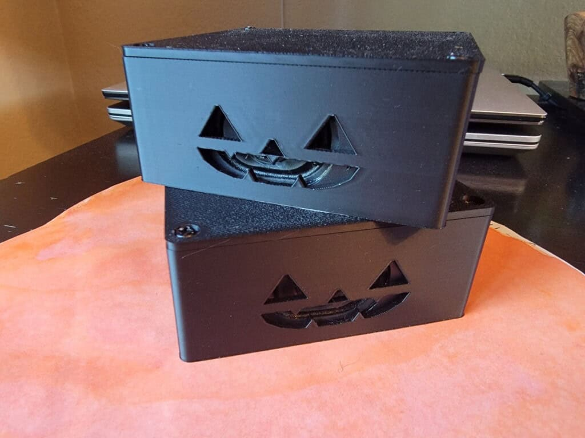
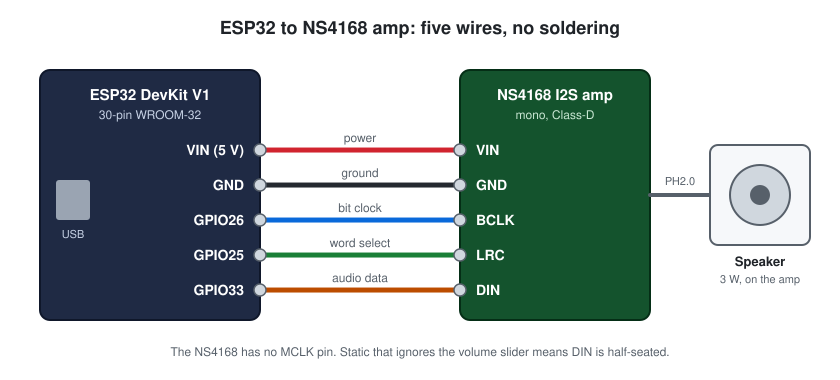
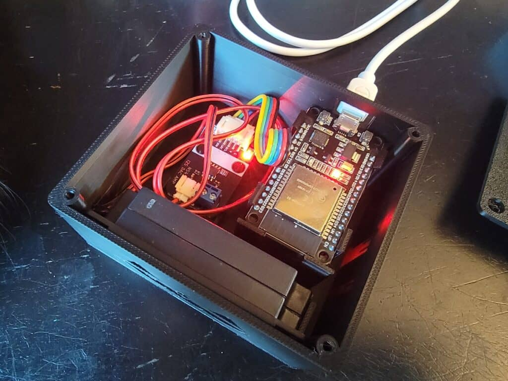

# Halloween Yard Speakers (ESP32 + NS4168, ESPHome)

Network speakers for about $20 a zone. Each one is a classic ESP32 dev board and a small I2S amp running ESPHome, and it shows up in Home Assistant as an ordinary `media_player` you can send clips and text-to-speech to. I built them to put growls and creaky doors in different corners of the yard on Halloween.

**Full write-up, with the story behind every setting:**
[How I Built Cheap ESP32 Yard Speakers for Halloween Sound Effects](https://www.allthethings.best/how-i-built-cheap-esp32-yard-speakers-for-halloween-sound-effects/)



## What's in this folder

| Path | What it is |
|---|---|
| [`esphome/yard-speaker.yaml`](esphome/yard-speaker.yaml) | The firmware config, commented |
| [`esphome/secrets.example.yaml`](esphome/secrets.example.yaml) | Template for the four secrets the config expects |
| [`esphome/test_tone.wav`](esphome/test_tone.wav) | 2 s tone baked into the firmware for the Test Tone button |
| [`case/`](case/) | OpenSCAD source, STLs and print notes for the enclosure |
| [`images/wiring.svg`](images/wiring.svg) | Wiring diagram |

## Parts

- **ESP32 dev board**, the classic 30-pin WROOM-32 DevKit V1 style. No PSRAM, which is why the buffers in the config are small.
- **NULLLAB NS4168 I2S amplifier and speaker kit.** A mono Class-D I2S amp that behaves like a MAX98357A, with a 3 W speaker and a PH2.0-to-Dupont cable.
- **Micro-USB cable and a 5 V USB power brick** per speaker.
- **3D printed case** (optional), in [`case/`](case/).
- **Home Assistant** with the ESPHome Device Builder.

The post has links to the exact parts I bought.

## Wiring



| Amp pin | ESP32 pin | Purpose |
|---|---|---|
| VIN (V) | VIN (5 V) | Power. Use 5 V for full volume. |
| GND (G) | GND | Ground, shared with the ESP32. |
| BCLK (BCL) | GPIO26 | Bit clock |
| LRC | GPIO25 | Word-select clock |
| DIN | GPIO33 | Audio data |

No soldering: the kit's cable pushes straight onto the ESP32 header pins, and the speaker plugs into the amp.

## Quick start

1. Copy `esphome/yard-speaker.yaml` and `esphome/test_tone.wav` into your ESPHome config folder.
2. Copy `esphome/secrets.example.yaml` to `secrets.yaml` in the same folder and fill it in. If you already have a `secrets.yaml`, add the four keys to it.
3. In the ESPHome dashboard (Chrome or Edge), choose **Install**, then **Plug into this computer**. The first flash has to go over USB. Later updates go over the air.
4. In Home Assistant, add the device under **Settings > Devices & Services**. You get `media_player.yard_speaker_a`, a **Test Tone** button and a **Heap Free** sensor.
5. Press **Test Tone** first. It proves wiring, power, I2S, amp and speaker in one go.

Then play something. The pipeline is announcement-only, so `announce: true` is required:

```yaml
action: media_player.play_media
target:
  entity_id: media_player.yard_speaker_a
data:
  media_content_id: media-source://media_source/local/halloween/growl.mp3
  media_content_type: music
  announce: true
```

Home Assistant converts whatever you send to 16 kHz WAV before it goes out, so source files can be MP3, FLAC or a TTS stream.

## More zones

Copy the YAML and change the two substitutions at the top:

```yaml
substitutions:
  device_name: yard-speaker-b
  friendly_name: Yard Speaker B
```

Each board becomes its own `media_player`. Target several in one action to play together, or put a delay between two actions for call and response across the yard.

## Troubleshooting

All of these are specific to a classic ESP32 without PSRAM paired with this NS4168 module. Each links to the longer explanation in the post.

| Symptom | Fix |
|---|---|
| [Audio plays at half speed](https://www.allthethings.best/how-i-built-cheap-esp32-yard-speakers-for-halloween-sound-effects/#half-speed) | Use `channel: stereo` at 16-bit. Mono at 44.1 kHz and 32-bit slots both play at half speed on this chip. |
| [Dead silence with correct wiring](https://www.allthethings.best/how-i-built-cheap-esp32-yard-speakers-for-halloween-sound-effects/#dead-silence) | `i2s_comm_fmt: stand_msb` (left-justified). Philips framing was silent at 16 kHz. |
| [Silence at some sample rates](https://www.allthethings.best/how-i-built-cheap-esp32-yard-speakers-for-halloween-sound-effects/#sample-rate) | The module only auto-detects 8, 16, 32, 44.1, 48 and 96 kHz. 22.05 kHz gives nothing. |
| [Pop on every restart, or "Speaker task setup failed"](https://www.allthethings.best/how-i-built-cheap-esp32-yard-speakers-for-halloween-sound-effects/#heap) | Buffers are too big for the ~200 KB heap. Keep Heap Free above about 120 KB. |
| [Clips stutter](https://www.allthethings.best/how-i-built-cheap-esp32-yard-speakers-for-halloween-sound-effects/#stutter) | `power_save_mode: none` on WiFi. |
| [Pop at the start of each clip](https://www.allthethings.best/how-i-built-cheap-esp32-yard-speakers-for-halloween-sound-effects/#clip-pop) | `timeout: never` on the speaker keeps the I2S bus running. |
| [Static that ignores the volume slider](https://www.allthethings.best/how-i-built-cheap-esp32-yard-speakers-for-halloween-sound-effects/#static) | Re-seat the DIN jumper and check it is on GPIO33. |

## Case



About 88 x 82 x 38 mm, prints without supports in PLA or PETG, with a jack-o'-lantern grille or plain slots. Files and print notes are in [`case/`](case/).

The case is **not weatherproof**. I put the speakers out for the evening and bring them back in. For wet weather, use a sealed outdoor enclosure or keep them under cover.

## Versions

Built and run on Home Assistant 2026.9 with ESPHome 2026.8.2. The config in this folder also validates on ESPHome 2026.10.2.

One difference from the config printed in the post: the media player here uses `name: None`, so the entity is `media_player.yard_speaker_a`. With a name that repeats the device name, Home Assistant creates `media_player.yard_speaker_a_yard_speaker_a`.

## License

Config and OpenSCAD source are MIT. The write-up, photos, diagram and STL files are CC BY 4.0. See the [repo README](../README.md#license).
