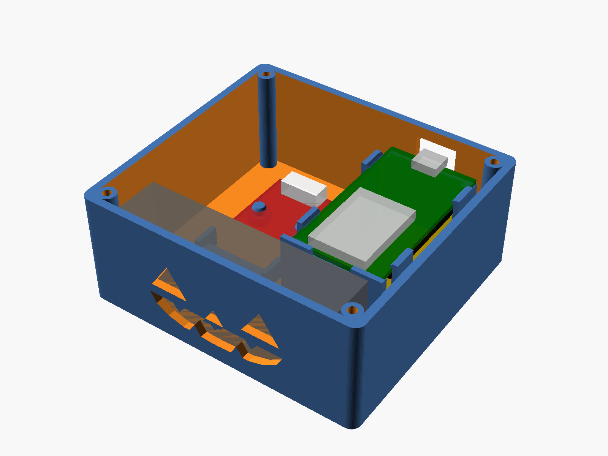

# Spooky Speaker Case

A 3D-printable enclosure for the [Halloween yard speaker](../README.md). Designed in OpenSCAD, so every dimension is a parameter you can change.



## What it fits

| Part | Dimensions used | Notes |
|---|---|---|
| ESP32 DOIT DevKit V1 style board (30-pin, micro-USB) | 51.8 × 28.2 mm PCB | Sits pins-down on four corner pads plus a thin ledge under each end, 22.5 mm off the floor so the Dupont jumpers hang free underneath. Four chamfered snap clips on the long edges hook over the board so it clicks in. Lid posts back that up. |
| NULLLAB NS4168 I2S amp module | 38.4 × 22.4 mm PCB | Two pegs go into its 4.8 mm Lego-style holes. PH2.0 input socket faces the back wall, speaker socket faces the speaker. |
| Enclosed speaker, 3 W 8 Ω | 70 × 31 × 16 mm | Drops into a pocket behind the front wall and fires through the grille. Held by ribs plus the lid, no screws. |

Outside size: **88 × 82 × 38 mm**. The micro-USB cable plugs into the **back wall**.

## Files

- `spooky_speaker_case.scad`: the parametric model (v3)
- `spooky_box_pumpkin.stl`: box with the jack-o'-lantern grille
- `spooky_box_slots.stl`: box with a plain slotted grille
- `spooky_lid.stl`: lid (same lid for either box)
- `previews/`: renders

**The STLs are the v2 export.** The `.scad` has one later tweak (v3): the ESP32 pocket is 1 mm shorter and the snap clips are thicker with a gusset at the root. If your board slides around in the v2 print, re-export from the `.scad`.

## Design history

- **v2**, after the first test print: ESP32 seat raised 5 mm because the jumper housings held the board up, pocket tightened, side walls replaced by snap clips, box 2 mm taller to keep solid wall above the raised USB cut-out, and two posts on the lid to stop the speaker rattling.
- **v3**, after the second print: ESP32 pocket 1 mm shorter, clips thicker and longer with a root gusset.

## Printing

- Material: PLA or PETG. Orange PLA for the pumpkin version.
- Layer height 0.2 mm, 3 perimeters, 20 % infill. No supports.
- Box: print as exported, open side up. The USB cut-out and the grille are in vertical walls and bridge fine.
- Lid: print as exported, lip and posts facing up.
- Optional hardware: 4 × M3 × 8 mm self-tapping screws for the lid. The lid also friction-fits with its lip.

## Assembly

1. Plug the speaker's PH2.0 lead into the amp's speaker socket, and the amp's PH2.0-to-Dupont cable into the amp's I2S socket.
2. Push the Dupont ends onto the ESP32 pins. The jumper housings hang below the board, which is why it sits 22.5 mm off the floor.
3. Drop the amp onto its two pegs, I2S socket toward the back wall.
4. Lower the ESP32 into its pocket, micro-USB end against the back wall so the port lines up with the cut-out. Press the long edges down past the four clips until it clicks onto the corner pads. To remove it, flex the clips outward with a fingernail and lift.
5. Slide the speaker into the front pocket, driver facing the grille. Coil the spare speaker cable in the open space.
6. Fit the lid: the two posts land on the antenna-end corners of the ESP32 and pin it down. Add screws if you like.

## Check before printing

The only dimensions that came from photos and a test fit, not a datasheet, are on the ESP32 board. Measure yours and adjust if needed:

- PCB outline should be about 51.8 × 28.2 mm (`esp_l`, `esp_w`). The `.scad` sets `esp_l` to 50.8 after a test fit on my board.
- The black pin-header housings should stop at least 4 mm short of each end of the board. The corner pads are 3.5 mm and the end ledges 1.5 mm, so this is the only way the supports could collide with a header. Shrink `esp_pad` / `esp_ledge` if your board is different.
- If your micro-USB cable has a chunky moulded plug, widen `usb_w` / `usb_h`.

## Useful parameters

| Parameter | Default | What it does |
|---|---|---|
| `grille` | `"jack"` | `"jack"` pumpkin face or `"slots"` horizontal slots |
| `part` | `"assembly"` | `"box"`, `"lid"`, `"both"` for export; `"open"` / `"assembly"` for viewing |
| `esp_pcb_z` | 22.5 | Height of the ESP32 board above the floor (room for jumpers underneath) |
| `esp_gap` | 0.5 | Total ESP32 pocket clearance; raise if the board won't drop in, lower if it slides around |
| `clip_hook` | 0.7 | How far the snap clips overhang the board edge; 0.5 for an easier click, 0.9 for a firmer grip |
| `clip_clear` | 0.25 | Gap between the board top and the hook underside |
| `amp_in_clear` | 12 | Space behind the amp for its input plug |
| `lip_clear` | 0.25 | Lid lip clearance; raise to 0.35 if your printer runs tight |
| `wall`, `floor_t`, `lid_t` | 2.4 / 2.0 / 2.4 | Shell thicknesses |

Re-export after changes:

```
openscad -o spooky_box_pumpkin.stl -D "part=\"box\"" spooky_speaker_case.scad
openscad -o spooky_box_slots.stl -D "part=\"box\"" -D "grille=\"slots\"" spooky_speaker_case.scad
openscad -o spooky_lid.stl -D "part=\"lid\"" spooky_speaker_case.scad
```
