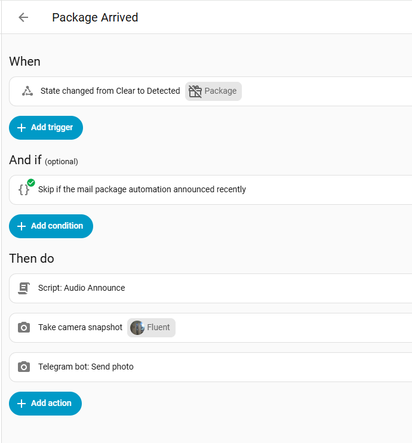

# Reolink Doorbell Package Alert (Home Assistant)

A Home Assistant automation that sends your phone a notification with a snapshot when a Reolink video doorbell detects a package. It uses Home Assistant's Reolink integration and the Home Assistant Companion app, with no Reolink cloud account or subscription. The notification itself travels through the Companion app's normal push service, and your phone loads the photo straight from Home Assistant.

This is the automation running at my front door, simplified. Mine also announces "A package has arrived!" on the house speakers, sends the photo through a Telegram bot, and has a condition that skips repeats (see [Variations](#variations)). The version here sends the photo to the Companion app instead, so it works without any of those.



*My own copy in the editor. The Audio Announce script and the Telegram step are the parts this version replaces with a phone notification.*

## What's in this folder

| Path | What it is |
|---|---|
| [`home-assistant/package_arrived.yaml`](home-assistant/package_arrived.yaml) | The automation, commented |
| [`images/automation-editor.png`](images/automation-editor.png) | Screenshot of the automation in the editor |

## What you need

- **A Reolink doorbell with package detection, added to Home Assistant** through the Reolink integration. Mine is the Reolink Video Doorbell WiFi (white). The integration creates a package sensor only on models that support package detection.
- **The Home Assistant Companion app** on your phone, signed in, with notifications allowed.
- **Remote access to Home Assistant** if you want the photo to show when you are away from home. The notification still arrives without it, but the image will not load.

## Quick start

1. In Home Assistant, go to **Settings > Automations & scenes** and select **Create automation > Create new automation**.
2. Open the three-dot menu and choose **Edit in YAML**.
3. Replace what is there with the contents of [`package_arrived.yaml`](home-assistant/package_arrived.yaml), from `alias:` down.
4. Change the three entity names to yours:

   | In the file | Change it to |
   |---|---|
   | `binary_sensor.front_doorbell_package` | Your doorbell's package sensor. The integration names it `binary_sensor.<camera name>_package`. |
   | `camera.front_doorbell_fluent` | Your doorbell's camera entity. The low-resolution Fluent stream is the one enabled by default. |
   | `notify.mobile_app_your_phone` | The notify action for your phone. Open **Settings > Tools > Actions** and search for `mobile_app` to see its exact name. Use this action, not **Send a notification message**, which cannot attach an image. |

5. Save, then test it with the three-dot menu's **Run actions**. That skips the trigger and any conditions, and sends a snapshot straight to your phone.

## How it works

- **Trigger.** The package sensor going from off to on. In the editor this reads "State changed from Clear to Detected".
- **Snapshot.** `camera.snapshot` saves a still from the doorbell to `/config/www/front_doorbell.jpg`. Home Assistant allows writing to the `www` folder by default. If you have never used that folder, create it and restart Home Assistant once, or the `/local/` address will not work.
- **Notification.** The Companion app loads the image from `/local/front_doorbell.jpg`, which is the same file: Home Assistant serves `/config/www/` at `/local/`.

## Variations

### Keep the snapshot private

Files in `www` are served without a login. Anyone who knows the address can open the latest snapshot. To keep it behind Home Assistant's authentication, save it to the media folder instead and change the two paths:

```yaml
      filename: /media/front_doorbell.jpg
```

```yaml
        image: /media/local/front_doorbell.jpg
```

Note the extra `local` in the second path. A file saved at `/media/front_doorbell.jpg` is addressed as `/media/local/front_doorbell.jpg` in a notification. `/media` is the media folder on Home Assistant OS and Container installs.

### Alert when someone rings instead

Swap the trigger entity for the doorbell's visitor sensor, `binary_sensor.<camera name>_visitor`, and change the message.

### Skip repeats

Replace `conditions: []` with this to ignore detections for 15 minutes after the automation last ran. `automation.package_arrived` has to be this automation's own entity ID. If you saved it under a different name, check the entity ID in the automation's settings. A test with **Run actions** also counts as a run, so real detections are ignored for the next 15 minutes.

```yaml
conditions:
  - alias: Skip if this automation ran in the last 15 minutes
    condition: template
    value_template: >-
      {{ (now() - (state_attr('automation.package_arrived', 'last_triggered')
      or as_datetime(0))).total_seconds() > 900 }}
```

I use the same condition at home, pointed at a second automation that watches for delivery emails, so the two do not both announce the same package.

## Troubleshooting

| Symptom | Likely cause |
|---|---|
| No package sensor on the device page | The doorbell model does not support package detection. The integration only adds sensors the device supports. |
| Notification arrives with no image | Your phone cannot reach Home Assistant from where it is. Set up remote access, or test on your home Wi-Fi first. |
| Notification arrives with no image, even on home Wi-Fi | The `www` folder was created after Home Assistant started. Restart Home Assistant once. |

## License

YAML is [MIT](../LICENSE). This README and the screenshot are [CC BY 4.0](https://creativecommons.org/licenses/by/4.0/), credit [allthethings.best](https://www.allthethings.best/).
